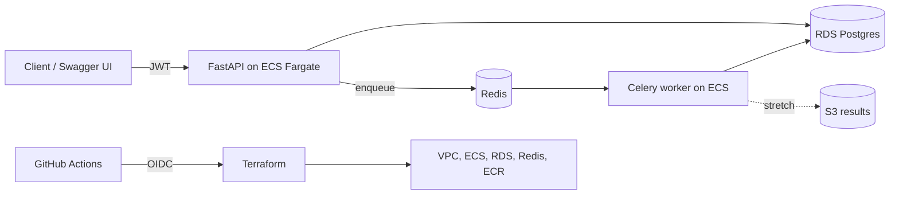

# Plan 2: Async Job Tracking API (build second)

## Goal
A FastAPI service where users submit jobs (for example document processing or report generation) that run on Celery workers through Redis, with status tracking stored in Postgres. Infrastructure on AWS is defined in Terraform and deployed through GitHub Actions.

Why second: P7, P8, and P9 (stated ranges between $135k and $210k across the three) all ask for Python + Postgres + AWS + CI. It also covers the Redis gap from the Topstep screen and the Python gap from the Affirm screen.

Job keywords it proves: Python, FastAPI, SQLAlchemy, Alembic, PostgreSQL query tuning, Redis, Celery, async tasks, pytest, Docker, Terraform, AWS ECS/RDS, GitHub Actions, OAuth/JWT.

## Scope
MVP:
- JWT auth (register, login, refresh).
- CRUD for projects and jobs; POST a job enqueues a Celery task; status moves queued, running, succeeded, failed.
- Retries with backoff, idempotency key on job submit, result stored in Postgres (and large output in S3 for stretch).
- Alembic migrations, seeded data script.
- Pagination, filtering, and at least two indexes justified with EXPLAIN ANALYZE before and after numbers.
- Terraform: VPC, ECS Fargate service (API + worker), RDS Postgres, Redis, ECR, CloudWatch logs.
- GitHub Actions: test, build, push image, terraform plan on PR, apply on tag.

Stretch:
- Rate limiting with Redis.
- WebSocket or SSE live status updates.
- Celery beat scheduled jobs, dead-letter handling for poison jobs.
- Load test with Locust to report p95 latency.
- OpenTelemetry traces across API and worker.

## Parameters
- Repo: pburt-dev/async-job-api (/app, /worker, /migrations, /tests, /infra/terraform, /docs)
- Stack: Python 3.12, FastAPI (current stable), Pydantic v2, SQLAlchemy 2.x (async), Alembic, Celery 5.x, Redis 7, PostgreSQL 16, uv or Poetry for deps, ruff + mypy, pytest + pytest-asyncio, Docker, Terraform 1.x with AWS provider, GitHub Actions with OIDC to AWS (no long-lived keys).

Architecture:

Data model:
- users: id, email (unique), password_hash, created_at
- projects: id, owner_id, name, created_at
- jobs: id, project_id, type, payload jsonb, status, attempts, idempotency_key (unique per user), error, created_at, started_at, finished_at
- job_events: id, job_id, from_status, to_status, at (audit trail)
- Indexes to justify: jobs(project_id, status, created_at), partial index on status in (queued, running)

API surface:
- POST /auth/register, POST /auth/login, POST /auth/refresh
- GET/POST /projects, GET/PATCH/DELETE /projects/{id}
- POST /projects/{id}/jobs (Idempotency-Key header), GET /projects/{id}/jobs?status=&cursor=
- GET /jobs/{id}, GET /jobs/{id}/events, POST /jobs/{id}/cancel
- GET /health, GET /ready (checks DB and Redis)
- OpenAPI at /docs

## Milestones (about 1 week each)
1. Setup: repo, uv/Poetry, docker compose (API, Postgres, Redis, worker), /health, ruff + mypy + pytest in CI.
2. Data layer: TODO SQLAlchemy models, Alembic initial migration, repository layer, seed script.
3. Auth: TODO password hashing, JWT issue and verify, dependency for current user, auth tests.
4. Jobs + Celery: TODO enqueue on POST, worker updates status, retries with backoff, idempotency key, integration tests with real Redis and Postgres.
5. Query tuning: TODO seed 100k+ jobs, capture EXPLAIN ANALYZE for list endpoints, add indexes, record before and after in docs/perf.md.
6. Terraform: TODO modules for network, RDS, Redis, ECS, ECR; remote state in S3; terraform plan in PR.
7. Deploy pipeline: TODO GitHub OIDC role, build and push image, ECS deploy on tag, smoke test after deploy, teardown workflow.
8. Polish: README, demo video, architecture diagram, resume bullets with real numbers, v1.0.0.

## Acceptance criteria / definition of done
- docker compose up runs API, worker, Postgres, Redis locally; README shows a curl walkthrough.
- A submitted job reaches succeeded or failed with a full event trail; a forced failure retries then fails cleanly.
- Same Idempotency-Key twice returns the same job, not a duplicate.
- docs/perf.md has real before and after p95 numbers for at least one query.
- terraform apply from a clean account creates the stack; terraform destroy removes it.
- Test coverage at least 80 percent on app code; all migrations reversible.

## Testing and CI
- pytest unit tests (services, auth), integration tests using Testcontainers or compose services for Postgres and Redis, Celery tasks tested both eagerly and with a real worker.
- CI: lint, type check, unit, integration, docker build, terraform fmt + validate + plan (PR), deploy on tag, secret scan.

## Deployment target
AWS with Terraform. Cost control: Fargate with smallest task sizes, RDS smallest instance within current free-tier terms, Redis as a small ElastiCache node or a Redis container sidecar if cost is a concern (document the tradeoff). Avoid NAT Gateway cost (public subnets with tight security groups, or VPC endpoints). Run terraform destroy after demos. Billing alarm at $10.

## README and demo for recruiters
- Pitch, 2-minute video (submit job, watch status, show retry, show Terraform plan in a PR), diagram, perf table, "design decisions" (why Celery, idempotency approach, index choices), cost notes, "what I would do next".

## Resume bullet template (fill with real numbers)
**Async Job Tracking API (personal project)** | Python, FastAPI, PostgreSQL, Redis, Terraform
- Built a FastAPI service with JWT auth, Alembic-managed Postgres schema, and Celery workers on Redis for background processing, covered by pytest integration tests.
- Provisioned AWS ECS and RDS with Terraform and deployed through GitHub Actions, using EXPLAIN-based index tuning to cut p95 query time from [X] to [Y] ms.

## Interview Coach practice
Drills and questions for this project: [Interview Coach chat](grokbot://app/v1/agent?id=98540b55-e842-4e85-83da-c2392987f3b4)
Topics: async vs sync in FastAPI, SQLAlchemy sessions, Alembic migrations, index design and EXPLAIN, Celery delivery guarantees and retries, idempotency, Redis data types, JWT pitfalls, Terraform state, ECS vs EKS.
